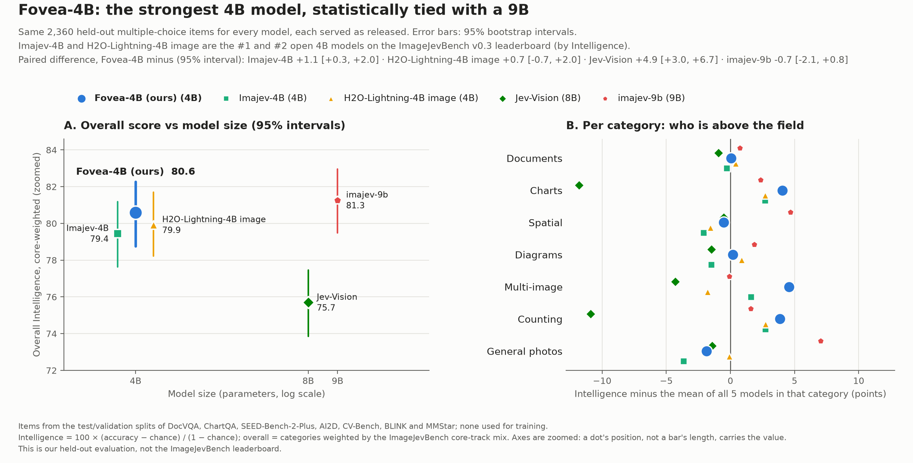

# Fovea-4B

Fovea-4B is a fast decision model for images. Given an image (a photo, document, receipt, chart or screenshot), a JSON
state and a typed question, it returns a probability for every allowed answer in a single forward pass. It is served
over TypeSafe's System One API, so any client of that API can call it unchanged.

- **Weights:** [huggingface.co/Sivasuthan/fovea-4b](https://huggingface.co/Sivasuthan/fovea-4b) (Apache-2.0)
- **Question types:** `noul` (yes/no), `choice` (named options), `score` (ordered levels)
- **Output:** every answer covers exactly the requested labels and sums to 1

## Results



We compare Fovea-4B with four open decision models: the two strongest open 4B models on the ImageJevBench v0.3
leaderboard by Intelligence, Imajev-4B (#1) and H2O-Lightning-4B image (#2), and two larger models, Jev-Vision (8B) and
imajev-9b (9B). All five answer the same 2,360 held-out multiple-choice questions, each served as its authors release
it, and are scored with the leaderboard's Intelligence formula, 100 × (accuracy − chance) / (1 − chance).

Fovea-4B scores 80.6 overall, the highest of the 4B models (Imajev-4B 79.4, H2O-Lightning-4B 79.9). Paired on the same
questions, it leads Imajev-4B by +1.1 points (95% interval +0.3 to +2.0) and H2O-Lightning-4B by +0.7 (−0.7 to +2.0). It
beats the twice-as-large Jev-Vision (75.7) by +4.9 (+3.0 to +6.7) and is statistically tied with imajev-9b (81.3; −0.7,
from −2.1 to +0.8) at less than half its size. By category it stands furthest above the field on multi-image comparison,
charts and counting. Its calibration error is the lowest of the 4B models (expected calibration error 0.035, against
0.059 and 0.061; imajev-9b 0.022, Jev-Vision 0.179).

**How each model was served.** Fovea-4B: images up to 2 MP, its calibrated temperatures. Imajev-4B: native resolution,
temperature 1.305. H2O-Lightning-4B image: images up to 1 MP, temperature 0.65. Jev-Vision: its own decision function,
images up to 1.29 MP, temperature 0.5. imajev-9b: native resolution, temperature 1.748.

**Evaluation data.** 2,360 multiple-choice questions from the test or validation splits of public benchmarks, none of
them used for training: DocVQA (400 document questions), ChartQA (300) and SEED-Bench-2-Plus charts (100), AI2D (300
diagrams) and SEED-Bench-2-Plus maps (100), CV-Bench (300: depth, distance, spatial relation and counting), BLINK (560:
spatial reasoning, counting and nine multi-image tasks) and MMStar (300 general photos). The overall score weights the
categories by the ImageJevBench core-track mix. This is our own held-out evaluation, not the ImageJevBench leaderboard:
it contains only multiple-choice questions, and leaderboard scores are lower and can rank models differently.

## Run the server

```sh
git clone https://github.com/Sivasuthan9/fovea && cd fovea
python3.12 -m venv .venv && . .venv/bin/activate
pip install torch==2.13.0 torchvision==0.28.0 --index-url https://download.pytorch.org/whl/cu130
pip install -r requirements.txt
python scripts/serve.py --model Sivasuthan/fovea-4b --revision 55c1dd919bc59dfd3316de6d752e18f3242ad385 --port 8000
```

One GPU with 16 GB or more is enough. Start-up downloads the weights (9 GB), records CUDA graphs and warms up the kernels;
the server prints `ready` when it accepts requests. Then:

```sh
curl -s http://127.0.0.1:8000/health
python scripts/test_contract.py http://127.0.0.1:8000 some_image.jpg   # checks every answer against the harness rules
```

## Request and response

```json
POST /v1/systemone
{"state": {"photo": "img-1"},
 "assets": {"img-1": {"type": "image", "format": "jpg", "data_base64": "..."}},
 "questions": {"decision": {"type": "choice",
                            "instructions": "What is the total on the receipt in `photo`?",
                            "criteria": {"12.40": null, "14.20": null, "21.40": null}}}}
```

```json
{"model": "fovea-4b",
 "answers": {"decision": {"type": "choice", "choice": "14.20", "confidence": 0.91,
                          "probabilities": {"12.40": 0.02, "14.20": 0.95, "21.40": 0.03}}},
 "usage": {"input_tokens": 1093, "output_tokens": 0, "total_ms": 41.7}}
```

- Images can be given as `assets` referenced from the state, instructions or criteria (TypeSafe's form), as
  `data:image/...;base64,` URIs inside any string, or as a top-level `images` list. Each becomes `[image k]` in the text.
- `noul` answers carry `"noul": p` (the probability of yes); `choice` and `score` answers carry `probabilities` over the
  option names or level indices, plus `choice` or `score` (the expected level) and `confidence`.
- Several questions per request are allowed. A question that cannot be scored gets a uniform answer, not an error.
- Images larger than the model's pixel budget (calibration.json, `max_pixels`) are downscaled, keeping the aspect ratio.

## Repository

| Path | What it is |
|---|---|
| `fovea/engine.py` | prompt, readout and model loading; `FastPath` (uint8 pixels normalised on the GPU, CUDA graphs) |
| `fovea/server.py` | the System One HTTP server (standard library) |
| `scripts/serve.py` | start the server |
| `scripts/test_contract.py` | contract test against a running server |

## Training

The model was trained on 57,441 typed image decisions built from public train splits (TextVQA, DocVQA, ChartQA, GQA,
ScienceQA, A-OKVQA), synthetic scenes with answers known by construction (counting, small text, misleading charts,
spatial relations) and Eikos text decisions, with a cross-entropy loss on the decision readout. A rank-32 LoRA on every
language-model projection and the readout were trained in two runs and averaged in weight space, then merged into the
weights. Details are in the model card.

## Licence

Apache-2.0 (LICENSE). Third-party work and the changes made are listed in NOTICE.
